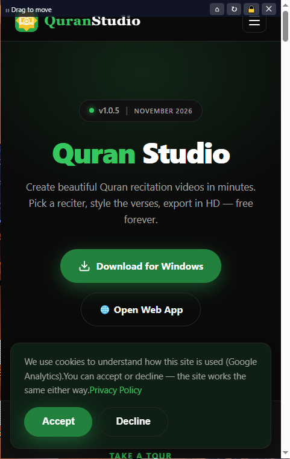
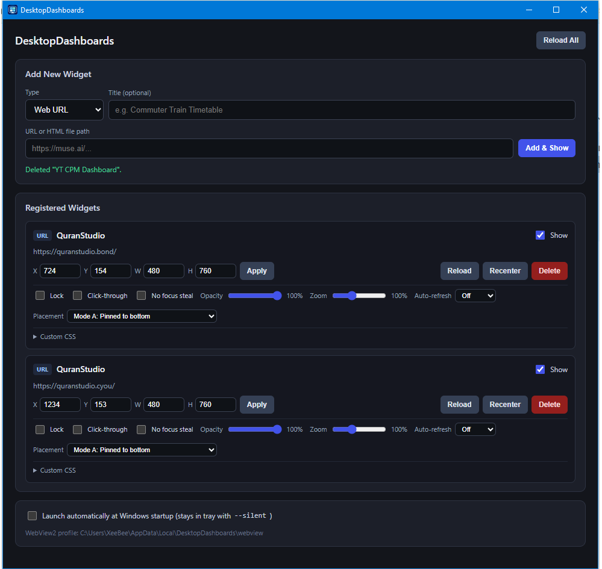
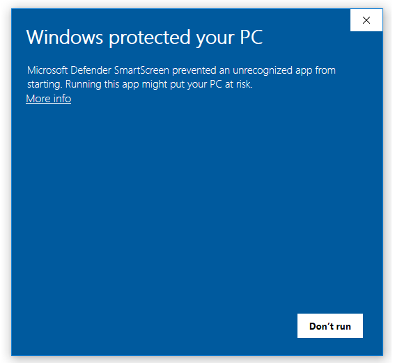

# DesktopDashboards

[](https://github.com/DashingMZA/DesktopDashboards/releases)
[](https://www.microsoft.com/windows)
[](LICENSE)

A lightweight desktop gadget app built with Tauri v2 + WebView2 that lets you keep multiple arbitrary web apps, AI artifacts (such as Muse Spaces), and local HTML files resident on your Windows desktop (at the very back / in the wallpaper layer).

<div align="center">
  <table>
    <tr>
      <td align="center" width="40%">
        <b>✨ Gadget on the desktop</b><br />
        
      </td>
      <td align="center" width="60%">
        <b>💬 DesktopDashboards Panel</b><br />
        
      </td>
    </tr>
  </table>
</div>

---

## 🌟 Key Features (Phases 1–3 implemented)

- **General-purpose web desktop gadgets**: Display web URLs and local HTML files (via the `widgetfile` custom protocol) as desktop widgets
- **Session persistence & isolation**: Uses a dedicated WebView2 `user_data_dir` (`%LOCALAPPDATA%\DesktopDashboards\webview`) to avoid lock conflicts with other apps while sharing login state across gadgets
- **External app integration & single-instance protection**: Seamless invocation via `tauri-plugin-single-instance` and CLI arguments
  - `DesktopDashboards.exe` (no arguments): Restores registered gadgets (brings the manager window to the front if already running)
  - `DesktopDashboards.exe --manager`: Brings the manager window to the front
  - `DesktopDashboards.exe --add-url <URL> [--title <NAME>]`: Adds and enables the specified URL and shows it
  - `DesktopDashboards.exe --silent`: Starts quietly in the tray without opening the manager window, launching only enabled gadgets
- **Desktop pinning & navigation control**:
  - **Mode A (pinned to bottom)**: Frameless, hidden from the taskbar, pinned to the very back (`HWND_BOTTOM` + `WS_EX_TOOLWINDOW` + `WM_WINDOWPOSCHANGING`)
  - **Mode B (embedded in wallpaper layer, Phase 3)**: Embeds into `Progman` / `WorkerW` to survive `Win + D` (switchable per gadget; supports automatic re-attachment after Explorer restarts and wallpaper changes)
  - **Navigation control**: Allows same-origin navigation and opens external links in the default browser
- **Gadget controls & customization (Phases 2–3)**:
  - **Lock feature**: When unlocked, hovering over the top edge shows an action bar (drag to move, home, reload, lock, close) and resizing is enabled; when locked, the bar and resizing are disabled (supports "Lock All / Unlock All" in the tray)
  - **Opacity + click-through**: `WS_EX_LAYERED` (20%–100%) and mouse pass-through via `WS_EX_TRANSPARENT`
  - **No focus stealing**: `WS_EX_NOACTIVATE` prevents clicks from taking focus away from other apps
  - **Zoom level**: Per-gadget zoom setting from 50% to 200%
  - **Periodic auto-reload + reload guard**: Auto-reload at 1–60 minute intervals, with protection that postpones reloads while an input field is focused or right after user interaction
  - **Custom CSS injection (Phase 3)**: Edit, instantly apply, and persist arbitrary CSS per gadget
- **Atomic settings persistence**: Atomic writes to `%APPDATA%\DesktopDashboards\config.json` (`.tmp` + flush + rename) with a one-generation backup (`.bak`) fallback
- **Manager window & system tray residency**: Add gadgets, toggle visibility, adjust position and size, configure detailed settings, delete gadgets, and toggle auto-launch at Windows startup (`--silent`)

---

## 📥 Installation

Download and run the installer (`DesktopDashboards_0.1.0_x64-setup.exe`) or the portable ZIP (`desktop-dashboards-x64.zip`) from [Releases](https://github.com/DashingMZA/DesktopDashboards/releases). The installer needs no administrator privileges (per-user installation), and the desktop shortcut and uninstaller are set up automatically.

### If a Windows SmartScreen warning appears

When you run the downloaded installer or portable version, you may see a blue screen saying **"Windows protected your PC"**. This is a safety-confirmation screen that SmartScreen shows automatically for a new binary from an individual developer / open-source project, treating it as an "unknown app with few downloads so far". You can still install and launch it with the steps below.

<div align="center">
  
</div>

1. Click **"More info"** (the underlined link) at the top left of the warning screen.
2. Click the **"Run anyway"** button that appears at the bottom right.
3. The setup screen (or the app) launches as usual.

> [!TIP]
> You can also avoid the warning by right-clicking the downloaded `.exe` file ➜ opening **"Properties"**, checking **"Security: Unblock"** (or "Unblock") at the bottom of the General tab, and clicking "OK".

---

## 📚 Documentation Structure

| Document | Role |
| :--- | :--- |
| **README.md** (this document) | Overview, quick start, and basic operations for this app |
| **[Customization Guide](docs/CUSTOMIZE.md)** | User reference (gadget settings, placement modes, tray menu details) |
| **[Feature Specification](docs/SPEC.md)** | **The implementation source of truth (Single Source of Truth)**. Feature spec (Draft v0.3), detailed behavior specification |
| **[Initial Design Document](DESIGN.md)** | Archive of the initial concept and design intent (the feature specification takes precedence for current behavior) |

---

## 🛠️ Development and Build Steps

### Requirements
- Windows 11 / 10
- Node.js 24+
- Rust (stable, MSVC toolchain)
- Visual Studio C++ Build Tools

### Starting development
```powershell
# Set PATH (if needed)
$env:PATH = "$env:USERPROFILE\.cargo\bin;C:\Program Files\nodejs;" + $env:PATH

# Install dependencies (first time only)
pnpm install

# Start development mode
pnpm dev
```

### Running automated tests
```powershell
# Rust unit tests (7 tests: CLI parsing, config, widget placement)
cargo test --locked --manifest-path "src-tauri/Cargo.toml"
```

There is no JavaScript test suite in this repo (no Vitest, no Playwright,
no `tests/` directory).

### Production build

Portable standalone executable (for manual placement / ZIP distribution):
```powershell
cargo build --release --manifest-path "src-tauri/Cargo.toml"
# Output: src-tauri/target/release/desktop-dashboards.exe
```

NSIS setup installer (for general distribution):
```powershell
pnpm build:installer
# or
npx tauri build
# Output: src-tauri/target/release/bundle/nsis/DesktopDashboards_<version>_x64-setup.exe
```

---

## 📜 License

[MIT License](LICENSE) © 2026 Muhammad Zaheer Ahmad. See the LICENSE file for details.

